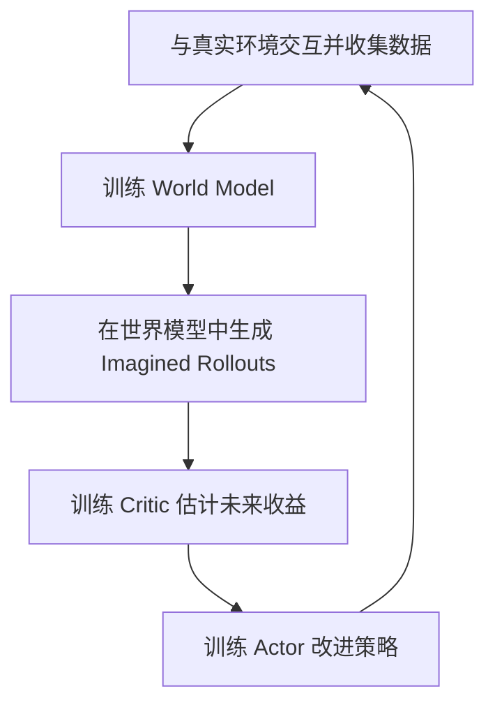

# 世界模型（World Model）入门教程

> 面向机器人控制与强化学习初学者。按照“为什么需要 → 是什么 → 基本结构 → 如何训练 → 如何决策 → 典型算法 → 概念辨析”的顺序理解世界模型。

## 1. 为什么机器人需要世界模型？

首先考虑一个简单任务：机械臂需要抓取桌面上的一个球。

一个典型的**反应式控制**流程是：

**观察环境 → 选择动作 → 执行动作 → 获取新观测 → 调整动作。**

这种控制方式可以借助反馈不断修正行为，但仅利用当前观测的反应式策略，未必会显式预测某个候选动作对未来环境的影响。

例如，机器人可能需要回答：

- 如果机械臂向前移动 10 cm，能否接触到球？
- 如果夹爪或机械臂对球施加一定的作用，球可能向哪里运动？
- 如果连续执行一系列动作，球最终可能停在哪里？

如果机器人能够在行动之前**预测不同动作的后果**，就可以比较候选方案，再选择更合适的动作。

**世界模型的动机：让智能体不仅能观察当前环境，还能根据动作推演未来。**

## 2. 什么是世界模型？

**世界模型（World Model）**是智能体对环境状态及其动态演化规律的一种内部表示。它的核心用途是：根据当前状态（或观测）和动作，预测环境未来可能如何变化。

### 2.1 从状态转移方程开始

考虑离散时间系统：

$$
s_{t+1}=f(s_t,a_t)
$$

其中：

- $s_t$：时刻 $t$ 的环境状态，例如物体位置、速度以及机器人状态；
- $a_t$：智能体在时刻 $t$ 执行的动作；
- $s_{t+1}$：下一时刻的状态；
- $f$：环境真实的状态转移规律。

如果真实函数 $f$ 不可直接获得，可以从交互数据中学习一个近似模型：

$$
\boxed{\hat{s}_{t+1}=f_{\theta}(s_t,a_t)}
$$

其中，$\theta$ 表示模型参数，$\hat{s}_{t+1}$ 为预测状态。这就是最简单的**学习型动力学世界模型**。

现实环境具有噪声、不确定性以及部分可观测性，因此也常用概率形式：

$$
\hat{s}_{t+1}\sim p_{\theta}(s_{t+1}\mid s_t,a_t)
$$

**注意：**世界模型不必一定由神经网络构成，也不必只预测一步；物理模型、概率模型和学习型模型都可以承担环境预测功能。

### 2.2 一步预测与多步预测

给定一组候选动作，可以递推得到未来状态：

$$
\hat{s}_{t+1}=f_{\theta}(s_t,a_t)
$$

$$
\hat{s}_{t+2}=f_{\theta}(\hat{s}_{t+1},a_{t+1})
$$

$$
\cdots
$$

$$
\hat{s}_{t+H}=f_{\theta}(\hat{s}_{t+H-1},a_{t+H-1})
$$

其中 $H$ 为预测时域。多步预测可以帮助机器人评估一个动作序列的后果，但模型误差也可能在多步递推中逐渐积累。

## 3. 现代学习型世界模型通常包含哪些模块？

真实机器人往往无法直接观测完整环境状态，只能获得相机图像、深度图、关节编码器或力传感器等信息。因此，现代世界模型常先构造**潜在状态（Latent State）**，再在潜在空间中预测未来。

### 3.1 状态编码器（Encoder）

以 RGB 图像为例，直接在高维像素空间预测未来可能计算昂贵。编码器把原始观测压缩为某种潜在表示：

$$
\boxed{z_t=E_{\theta}(o_t)}
$$

其中：

- $o_t$：机器人获得的观测；
- $E_{\theta}$：编码器；
- $z_t$：学习得到的潜在状态。

潜在状态未必对应明确的物理量（如三维位置和速度），但理想情况下能够保留与未来预测、控制决策有关的信息。

### 3.2 动力学模型（Dynamics Model）

动力学模型描述潜在状态在动作作用下如何演化：

$$
\boxed{\hat z_{t+1}=F_{\theta}(z_t,a_t)}
$$

或在随机模型中写为：

$$
\hat z_{t+1}\sim p_{\theta}(z_{t+1}\mid z_t,a_t)
$$

这部分是世界模型进行**想象（imagination）或未来推演**的基础。

### 3.3 奖励预测模型（Reward Model）

在强化学习任务中，通常还需要衡量某种行为是否有利，因此世界模型可能包含奖励预测模块：

$$
\boxed{\hat r_t=R_{\theta}(z_t,a_t)}
$$

例如：成功抓取可以获得较高奖励，碰撞或任务失败可能获得较低奖励。

**需要区分：**奖励模型是许多*强化学习世界模型*的组成部分，但并非所有世界模型都需要预测奖励。只承担环境状态预测任务的模型，也可以被称为世界模型。

## 4. 世界模型如何训练？

### 4.1 收集交互数据

机器人与环境交互，形成状态转移数据：

$$
\mathcal D=\{(s_t,a_t,s_{t+1})\}_{t=1}^{N}
$$

如果不能直接获得环境状态，则收集观测与动作数据，例如：

$$
\mathcal D=\{(o_t,a_t,o_{t+1},r_t)\}_{t=1}^{N}
$$

这些数据可以来自真实机器人、仿真环境，或二者结合。

### 4.2 最简单的监督学习方式

如果可以获取状态 $s_t$，可以让模型预测下一状态，并最小化预测误差：

$$
\boxed{
\mathcal L(\theta)
=\frac{1}{N}\sum_{t=1}^{N}
\left\|f_{\theta}(s_t,a_t)-s_{t+1}\right\|_2^2
}
$$

训练的目的就是使模型预测尽可能接近真实的状态变化。

### 4.3 潜在状态模型的训练

当模型使用高维视觉观测时，损失函数通常会更复杂，可能组合：

- **观测重建损失**：让潜在状态保留重要观测信息；
- **状态预测或潜在一致性损失**：让预测的潜在动态与真实观测推断出的状态一致；
- **奖励预测损失**：使预测奖励接近环境提供的奖励；
- **正则化项**：避免潜在表示或概率分布出现不期望的退化。

具体训练目标取决于采用的模型架构，并非每个方法都具有上述全部损失。

这一节可以归纳为：

**真实交互产生数据 → 利用数据学习环境动态 → 世界模型获得预测能力。**

## 5. 训练好的世界模型如何用于机器人决策？

这里需要明确一个关键区分：

- **世界模型回答：**执行某个动作后，环境可能如何变化？
- **规划器或策略回答：**为了实现任务目标，应该执行哪个动作？

世界模型提供预测，但动作选择还需要规划、优化或强化学习策略。

### 5.1 路线一：世界模型 + 模型预测控制（MPC）

假设已经学得状态预测模型：

$$
\hat{s}_{t+1}=f_{\theta}(s_t,a_t)
$$

MPC 可以利用它优化未来 $H$ 步的动作序列。一个简化的有限时域优化问题是：

$$
\min_{a_t,\ldots,a_{t+H-1}}
\sum_{k=0}^{H-1}
\ell(\hat{s}_{t+k},a_{t+k})
$$

满足：

$$
\hat{s}_{t+k+1}
=f_{\theta}(\hat{s}_{t+k},a_{t+k}),
\qquad k=0,\ldots,H-1
$$

其中 $\ell$ 是任务代价函数。实际 MPC 往往还包括动作约束、状态约束和终端代价。

MPC 的执行方式是：

1. 根据当前状态预测未来若干步；
2. 求解使预测代价最小的动作序列；
3. **只执行第一个动作**；
4. 获取新观测，重新预测并优化。

它与传统 MPC 的思想是一致的，只是预测模型可以来自数据学习，而不必完全依赖手工推导的物理动力学。

### 5.2 路线二：世界模型 + 强化学习（Model-Based RL）

强化学习希望学到一个策略，使长期累积奖励尽可能大。策略可以写为：

$$
a_t\sim\pi_{\phi}(a_t\mid z_t)
$$

在基于世界模型的强化学习中，机器人不仅能够通过真实交互学习，也可以借助学到的动力学模型，在内部生成预测轨迹：

$$
\hat z_{t+1}\sim p_{\theta}(z_{t+1}\mid z_t,a_t)
$$

$$
a_{t+1}\sim\pi_{\phi}(a_{t+1}\mid\hat z_{t+1})
$$

持续递推，就得到一段预测的状态、动作和奖励序列。这类轨迹通常称为 **Imagined Rollouts（想象轨迹）**。

智能体可以利用这些轨迹改进策略，从而在一定程度上减少昂贵的真实环境交互。

不过，**想象轨迹的可靠性取决于模型精度**。当模型误差较大时，基于错误预测优化出的策略也可能表现不佳。

### 5.3 两条路线的区别

| 方面 | 世界模型 + MPC | 世界模型 + 强化学习 |
|---|---|---|
| 如何选动作 | 在线求解规划或优化问题 | 学习一个策略网络，或结合规划 |
| 世界模型的主要用途 | 在线预测并评价候选动作序列 | 提供虚拟交互数据或辅助价值/策略学习 |
| 是否必须训练 Actor | 否 | 不一定，取决于算法 |
| 是否每一步在线优化 | 通常是 | 不一定；某些方法执行时直接使用策略网络 |

这两类方法也可以组合，并非互相排斥。

## 6. 代表性算法：Dreamer 系列

**Dreamer** 是将学习型世界模型与强化学习结合的代表性算法系列。以 DreamerV3 为例，可以先从三个核心角色理解其工作方式。

| 模块 | 主要功能 | 它回答的问题 |
|---|---|---|
| World Model | 学习环境动态，预测潜在状态及奖励 | “未来可能发生什么？” |
| Actor | 根据状态产生动作 | “我应该采取什么动作？” |
| Critic | 估计未来累计收益 | “当前状态或行为预计有多大价值？” |

Dreamer 的训练可以概括为以下循环：

直观理解：

1. 通过真实交互数据训练世界模型；
2. 使用世界模型在潜在空间中生成想象轨迹；
3. 依据想象轨迹的预测奖励和价值估计更新 Actor 与 Critic；
4. 使用策略继续与真实环境交互，并不断更新模型和策略。

**重要区别：**Dreamer 的 Actor 在执行阶段通常能够直接根据当前的内部状态产生动作，并不要求每个控制周期都在线求解一个 MPC 优化问题。

## 7. 世界模型与其他概念有什么关系？

| 概念 | 主要问题或功能 | 与世界模型的关系 |
|---|---|---|
| World Model | 环境如何在动作作用下演化？ | 提供预测能力 |
| MPC | 如何优化未来一段时间内的动作？ | 可以使用世界模型作为预测模型 |
| Model-Based RL | 如何利用环境模型改善策略学习或决策？ | 可以使用学习型世界模型 |
| Model-Free RL | 如何不显式学习环境转移模型而优化策略或价值？ | 通常不需要显式世界模型 |
| Actor-Critic | 如何结合策略与价值估计优化行为？ | 可用于 Model-Free RL，也可与世界模型结合 |

### 7.1 结合传统机器人控制理解

如果已经熟悉系统动力学、MPC 或机器人运动控制，可以建立以下联系：

- **动力学建模与系统辨识**：帮助理解世界模型如何描述状态转移；
- **状态估计**：帮助理解为什么需要从部分观测构建内部状态；
- **MPC**：帮助理解如何利用模型预测选择动作；
- **强化学习**：帮助理解如何利用奖励、价值函数与策略学习来改进决策。

例如，在已知频率的周期目标跟踪问题中，内模原理（IMP）利用已知动态结构设计跟踪控制器；学习型世界模型则可以从数据中预测目标或机器人未来状态。

二者目的与理论性质不同：**IMP 可在相应假设下给出渐近跟踪等理论保证；学习型世界模型的预测精度和闭环稳定性通常需要分别分析与验证**。对于已知结构、规律明确的任务，不应默认复杂学习型模型优于简洁的物理模型或内模控制器。

## 8. 总结与建议学习路线

学习世界模型时，最重要的是分清三个层次：

1. **环境建模（Modeling）**：根据状态和动作预测环境变化。
2. **决策与规划（Decision Making / Planning）**：利用预测选择动作。
3. **控制与交互（Control / Interaction）**：在真实环境中执行动作、获得反馈并更新信息。

一句话总结：

> **世界模型负责预测未来，规划器或策略负责选择动作，机器人通过真实交互不断检验与修正内部模型。**

推荐的入门学习顺序：

**动力学建模与系统辨识 → Model-Based RL → 潜在状态与潜在动力学模型 → 想象轨迹（Imagined Rollouts）→ Dreamer 系列 → 世界模型与 MPC/机器人控制的结合。**

